# AI-driven Zero Trust IAM — PBCA

**Policy-Bounded Continuous Authorization (PBCA)**: a working prototype of the framework proposed in
*"Policy-Bounded Risk Scoring with Artificial Intelligence for Continuous Authorization in Zero Trust
Identity and Access Management"* (Shreya Pandey, Suhani Shah, Avani Srivastava — MIT World Peace University).

A risk engine scores both the **login** and the **ongoing session**, and passes a risk value, a confidence
value and an explanation to a rule-based **policy decision point**. The two decisions are combined so that
the model can make access **stricter but never more permissive** than mandatory policy:

```
d = stricter(d_P, d_R) = max(d_P, d_R)        Allow < Step-up < Restrict < Deny
```

Stricter decisions reach live sessions through **OpenID CAEP** events, and every decision is written to a
hash-chained audit log together with its feature attributions.

> The paper is at design stage. Everything here runs on **synthetic data** unless you plug in the public
> datasets (see [Evaluation](#evaluation)). Numbers in `reports/` check that the pipeline works; they are not
> experimental results.

---

## Quick start

```bash
pip install -r requirements.txt
```

```bash
python -m pbca.simulation.scenario          # case walk-through (Table V)
```

```bash
uvicorn pbca.web.app:app --reload           # dashboard at http://127.0.0.1:8000
```

```bash
python -m pbca.evaluation.harness           # RQ1–RQ4 report -> reports/evaluation.md
```

```bash
python -m pytest -q                         # 54 tests, incl. property-based policy-bounding test
```

Python 3.10+.

## Architecture (Fig. 1)

```mermaid
flowchart TB
  A[Access request<br/>user · device · app · session] --> B[Signal collection<br/>identity · device posture · behavior · context · threat intel]
  subgraph CP[Trusted control plane]
    B --> C[AI risk engine<br/>L1 login likelihood ratio · L2 session isolation forest<br/>→ r, c, explanation]
    C --> D[Policy decision point<br/>d_P mandatory rules · d_R risk tier<br/>d = stricter&#40;d_P, d_R&#41;]
  end
  D --> E[Policy enforcement point<br/>Allow · Step-up · Restrict · Deny · Revoke via CAEP]
  E --> F[Resources & monitoring<br/>banking apps · customer DB · audit log · SIEM]
  F -. session events re-enter as new evidence .-> B
```



The risk engine is the **only** ML component and it decides nothing. The PDP decides; the PEP enforces.

## Paper → code map

| Paper | What | Code |
|---|---|---|
| Table II | Signals and data minimization (salted IP hash, country-level location, counts not content) | `pbca/signals.py`, `pbca/privacy.py` |
| Eq. 1 | Layer 1 login risk: Freeman et al. likelihood ratio, hierarchical smoothing (IP→ASN→country, UA→OS→device type), hash-table counts, `r_L = R_L/(1+R_L)` | `pbca/risk/login.py` |
| Eq. 2 | Layer 2 session anomaly: isolation forest per peer group over 5-min windows, attributions for high-scoring windows (SHAP if installed, otherwise occlusion) | `pbca/risk/session.py` |
| Eq. 3, 4 | Noisy-OR aggregation `r = 1-(1-r_L)(1-r_S)`, confidence `c = min(1, n_u/8)` | `pbca/risk/engine.py` |
| Table III, Eq. 5 | Mandatory ABAC rules → `d_P`; thresholds τ1<τ2<τ3 per sensitivity → `d_R`; low-confidence floor at Step-up; `d = stricter(d_P, d_R)` | `pbca/policy.py`, `pbca/decisions.py` |
| — | Same policy in Rego for Open Policy Agent | `policies/pbca.rego` |
| §V-H | Continuous monitoring: triggers (sensitive resource, device compliance, threat intel, behavior window, periodic Δt), CAEP SETs (`session-revoked`, `credential-change`, `token-claims-change`), time to containment | `pbca/system.py`, `pbca/caep.py` |
| §VII | Append-only hash-chained audit log | `pbca/audit.py` |
| Table V | Case walk-through | `pbca/simulation/scenario.py` |
| §V-I | Baselines B0, B1, B2, PBCA | `pbca/evaluation/baselines.py` |
| Table IV | RQ1–RQ4 metrics, temporal split, property test, containment, latency, FRR per group, threshold sweep, signal ablation | `pbca/evaluation/harness.py` |
| §V-I | Loaders for the RBA login dataset and CERT Insider Threat dataset | `pbca/evaluation/datasets.py` |
| Prototype | Demo bank app as CAEP receiver, REST API, dashboard | `pbca/web/` |

### Mandatory rules (d_P)

| Rule | Condition | Minimum decision |
|---|---|---|
| R1 | Unmanaged device opening unmasked customer records | Deny |
| R2 | Managed but non-compliant device (patch age > 30 d or EDR off) on a high-sensitivity resource | Restrict |
| R3 | Privileged role without phishing-resistant MFA | Step-up |
| R4 | Source IP on threat-intel block list | Deny |
| R5 | Leaked credential without phishing-resistant MFA | Step-up |
| R6 | Export of customer data from a non-compliant device | Deny |

### Starting thresholds (Table III)

| Sensitivity | Example | τ1 (Step-up) | τ2 (Restrict) | τ3 (Deny) |
|---|---|---|---|---|
| Low | intranet, HR self-service | 0.50 | 0.80 | 0.95 |
| Medium | internal reporting | 0.35 | 0.65 | 0.90 |
| High | customer records, payments | 0.20 | 0.50 | 0.80 |

## Case walk-through (Table V)

`python -m pbca.simulation.scenario` trains both layers on a synthetic workforce and plays the case end to end:

```
1. Employee, managed laptop, office network
   signals : rL=0.00; rS=0.00; c=1.00
   decision: Allow

2. Stolen password, unmanaged device, new ASN
   signals : rL=1.00; rS=0.00; c=1.00
   decision: Deny at login

3. Same attacker, model fooled (risk forced to 0)
   signals : r=0.00; d_R=ALLOW; d_P=DENY (R1)
   decision: Deny / revoke on customer records: policy bound holds

4. Stolen session token on managed device
   signals : rL=0.00; rS=0.00; c=1.00
   decision: Allow, monitored

5. Bulk record viewing and export
   signals : rL=0.00; rS=1.00; c=1.00; top feature: exports
   decision: Deny / revoke; alert analyst
   CAEP    : session-revoked

6. Compromise confirmed
   decision: Revoke via CAEP; reset credentials
   CAEP    : credential-change, session-revoked
```

Step 3 is an extra row that shows policy bounding directly: even if the model is fooled into scoring the
attacker at zero, rule R1 keeps customer records closed.

Two rows are stricter than the paper's illustrative table, and they are left as the model's real output:

- **Step 2.** The attacker is denied at login, rather than denied only on sensitive resources, because r_L saturates.
- **Step 5.** The bulk-export window revokes the session (r_S = 1 ≥ τ3), rather than only restricting it.

## Dashboard

`uvicorn pbca.web.app:app` starts the demo service. The dashboard lets you:

- log in as an employee or as one of three attackers (stolen password abroad, same-country proxy with a
  copied browser, replayed session token);
- request resources, and feed normal, bulk-export or mimicry behavior windows;
- trigger device-compliance changes, threat-intel matches, step-up, the periodic Δt check and analyst
  confirmation;
- watch the decision feed (d_P, d_R, r, r_L, r_S, c and explanations), the CAEP events received by the demo
  bank app, and the audit-chain status;
- use the **policy-bounding playground**: force any risk score and see PBCA stay at or above d_P while the
  unbounded B2 goes looser than policy.

API docs are at `/docs`. `POST /api/caep/receiver` is an SSF push endpoint that accepts signed SETs.

## Evaluation

`python -m pbca.evaluation.harness` runs B0 (MFA always), B1 (static rules), B2 (same model, unbounded) and
PBCA on the same events. It uses a **temporal split**: train on months 1–3, test on month 4. It writes
`reports/evaluation.md` and `reports/evaluation.json`.

| RQ | Measured |
|---|---|
| RQ1 | TPR at 1/5/10 % FPR, ROC-AUC, detection by attack kind, step-ups per 100 genuine logins — login and session phases |
| RQ2 | Decisions looser than d_P on all test events, plus a 5,000-request fuzz with forced-zero risk scores |
| RQ3 | Behavior windows to containment, trigger→enforcement latency, records exposed: CAEP vs. waiting for token expiry |
| RQ4 | p50/p95 decision latency, step-up rate per user group (frequent vs. infrequent, role), threshold sweep, login-signal ablation |

Highlights from the synthetic run (`reports/evaluation.md`):

- **RQ2.** PBCA produced 0 decisions looser than policy, against 2,404 of 5,000 for B2 in the fuzz test.
- **RQ3.** Bulk misuse was contained in the first window in every session: about 186 records exposed, versus about 1,147 when waiting for token expiry. Patient mimicry was contained before token expiry in only about 19% of sessions, consistent with the paper's expectation that mimicry evades anomaly scoring.
- **RQ4.** Infrequent users were sent to step-up about 5× as often as frequent users (19.4% vs 3.7%), the effect Wiefling et al. report.

**Reading these numbers.** The synthetic attacks are easy to separate at login. A login from a foreign
network or an unmanaged device saturates r_L, and rule R1 blocks it anyway. A replayed token is invisible at
login by design. This is why the threshold sweep and login-signal ablation are almost flat here, and why
login ROC-AUC is capped near 0.8. The real datasets are needed to say anything about RQ1 and RQ4.

### Running on the public datasets

```python
from pbca.evaluation.datasets import load_rba, load_cert_windows
logins = load_rba("rba-dataset.csv")                                  # Wiefling et al. 2022
windows = load_cert_windows("r4.2/", "answers/insiders.csv")          # CERT Insider Threat
```

The RBA data has no device-management flag, so drop `managed_device` from `LoginRiskModel(features=...)`.
The CERT mapping to window features is documented in `datasets.py`.

## Implementation notes and deviations

- **Session-score calibration.** A raw isolation-forest score is about 0.4–0.5 even for normal windows.
  Feeding it straight into noisy-OR would push everyone toward Restrict. `r_S` is therefore rescaled against
  each peer group's training scores: 0 up to the 97.5th percentile, rising to 1 at a raw score of 0.75. This
  step is not in the paper; it is one of the RQ4 knobs.
- **Login prior.** `P(u|L)` is shrunk toward the average user, so a user with no history at most doubles
  R_L. Low history is handled by the confidence floor rather than being counted twice. `prior_odds = 0.1` is
  a tunable constant.
- **Explanations.** SHAP is used when it is installed (`pip install shap`). Otherwise attributions come from
  occlusion: each feature is replaced with the peer-group median and the score change is recorded. Either way
  they are stored only for windows that raise risk.
- **CAEP.** SETs are signed with HS256 and a shared secret, to keep the demo dependency-free. Production
  would use asymmetric keys and a JWKS. RESTRICT and STEP_UP are sent as `token-claims-change` with a
  `pbca_tier` claim.
- **Keycloak / OPA.** The prototype runs the IdP and PDP roles in-process. `policies/pbca.rego` mirrors the
  Python PDP for Open Policy Agent, but has not yet been run against an OPA binary in CI.
- **Limitations from the paper still apply.** The data is synthetic, noisy-OR assumes independent layers,
  mimicry attackers evade anomaly scoring, and policy bounding is only as good as the written policy.

## Project layout

```
pbca/
  decisions.py        ordered decisions, stricter() — Eq. 5
  signals.py          Table II signal model
  privacy.py          IP hashing, minimization
  risk/               login.py (Eq. 1) · session.py (Eq. 2) · engine.py (Eq. 3–4)
  policy.py           mandatory rules, Table III thresholds, PDP
  caep.py             SSF/CAEP SETs, transmitter, demo bank receiver
  audit.py            hash-chained audit log
  system.py           sessions, PEP, continuous re-evaluation
  simulation/         synthetic workforce, Table V scenario
  evaluation/         baselines, metrics, harness, dataset loaders
  web/                FastAPI app + dashboard
policies/pbca.rego    OPA version of the PDP
tests/                pytest + hypothesis
reports/              generated evaluation report
```

## References

1. S. Rose et al., *Zero Trust Architecture*, NIST SP 800-207, 2020.
2. D. M. Freeman et al., "Who Are You? A Statistical Approach to Measuring User Authenticity," NDSS 2016.
3. S. Wiefling et al., "Pump Up Password Security! Evaluating and Enhancing Risk-Based Authentication on a Real-World Large-Scale Online Service," ACM TOPS 26(1), 2022.
4. F. T. Liu, K. M. Ting, Z.-H. Zhou, "Isolation Forest," ICDM 2008.
5. OpenID Foundation, *Shared Signals Framework 1.0* and *CAEP 1.0*, 2025.
6. D. Arp et al., "Dos and Don'ts of Machine Learning in Computer Security," USENIX Security 2022.
7. CERT Insider Threat Test Dataset, Carnegie Mellon University SEI.
